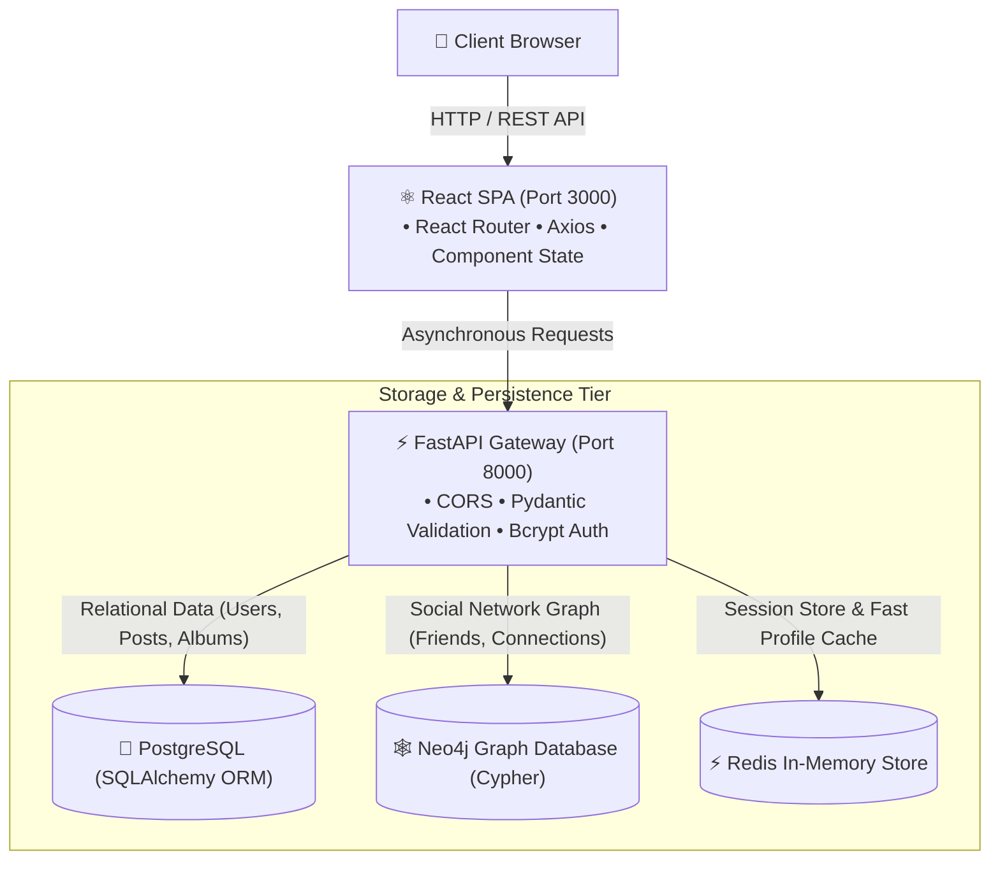

# Full-Stack Social Platform · React 19 & FastAPI

[](https://react.dev/)
[](https://fastapi.tiangolo.com/)
[](https://www.python.org/)
[](https://www.postgresql.org/)
[](https://neo4j.com/)
[](https://redis.io/)
[](https://ac.utcluj.ro/)

> **Note on Collaboration:** Academic team project developed for the *Dezvoltarea Interfețelor și Sistemelor Interactive (DISI)* course at the **Technical University of Cluj-Napoca (TUCN)**. Forked from the course organization repository [DISI2025/30641_Ghilea_Lucian_SocialPlatform](https://github.com/DISI2025/30641_Ghilea_Lucian_SocialPlatform), showcasing 180+ team commits, Agile sprint deliveries, and 80+ peer-reviewed Pull Requests.

---

An end-to-end social networking platform built with a decoupled **React 19 SPA** frontend and an asynchronous **FastAPI** backend. 

The project features a **multi-database architecture**: **PostgreSQL** for relational user data, **Neo4j** for graph traversal of friendships and social recommendations, and **Redis** for in-memory session management and sub-millisecond profile caching.

---

## 🏛️ System Architecture



---

## ✨ Key Features

### ⚛️ Frontend (React Single-Page Application)
- **Interactive Chat Interface (`ChatPage.js`)**: Direct messaging between users, conversation switching, new chat modal, and message thread history.
- **Dynamic Social Newsfeed**: Personalized feed displaying user posts, captions, timestamps, and attached media.
- **Photo Albums & Gallery (`Album.js`)**: Multi-photo uploading, image browsing, and album categorization.
- **Friend Discovery & Management (`FriendsList.js`)**: Search directory, pending friend requests management, and mutual connections view.
- **Profile Customization (`Profile.js`, `ProfileUpdate.js`)**: Bio editing, avatar picture upload, and personalized stats.
- **Responsive Navigation & Routing**: Client-side routing managed through `react-router-dom` with modular styling.

### ⚡ Backend (FastAPI Asynchronous Services)
- **Multi-Database Persistence Layer**:
  - **PostgreSQL**: Stores relational models (`User`, `Foto`, `AlbumPhoto`, `Message`, `Conversation`) with SQLAlchemy 2.0 ORM.
  - **Neo4j Graph Database**: Models social relations as nodes and directed edges for efficient friendship queries and mutual friend discovery.
  - **Redis Cache**: Caches serialized user profiles and manages session state to eliminate redundant relational database queries.
- **Robust Security & Authentication**:
  - Bcrypt password hashing (`passwords.py`).
  - Account registration, credential verification, and secure password reset flow.
- **Automated Testing Suite**:
  - Pytest integration suite verifying API endpoints (`test_profile.py`, `test_reset.py`).
  - Redis cache lifecycle and TTL expiry tests (`test_cache_profile.py`, `test_expiry.py`).
- **Strict Data Validation**: Pydantic v2 schemas for all request payloads and response serialization.
- **Modular Routers**: Clean separation of concerns with dedicated routers for `users`, `albums`, and `messages`.

---

## 🛠️ Tech Stack & Technologies

| Layer | Technologies |
| :--- | :--- |
| **Frontend** | React 19, React Router v7, Axios, Modern CSS3 Flexbox/Grid, Web Vitals |
| **Backend API** | FastAPI, Uvicorn (ASGI server), Starlette, Pydantic v2 |
| **ORM & Database** | SQLAlchemy 2.0, PostgreSQL (`psycopg2-binary`) |
| **Graph Database** | Neo4j (`neo4j` Python driver, Cypher query language) |
| **Cache & In-Memory**| Redis (`redis-py`) for caching and session management |
| **Security** | Bcrypt password hashing, CORS Middleware |

---

## 📁 Repository Structure

```text
social-platform-fullstack/
├── docs/
│   ├── 404NotFound - PrezentareSprint1.pdf              # Sprint 1 architecture & design presentation
│   └── Dezvoltarea Aplicației Web – Social Platform.pdf # Final technical documentation & report
├── frontend/
│   ├── public/                                         # Static assets & HTML template
│   ├── src/
│   │   ├── pages/                                      # React Page Components
│   │   │   ├── ChatPage.js / .css                      # Messaging and conversation view
│   │   │   ├── CreatePost.js / .css                    # Post creator with photo upload
│   │   │   ├── FriendsList.js / .css                   # Friends directory & search
│   │   │   ├── Profile.js / .css                       # User profile view
│   │   │   ├── ProfileUpdate.js / .css                 # Profile settings & photo change
│   │   │   ├── Album.js / .css                         # Photo albums view
│   │   │   ├── SignIn.js / Register.js                 # Authentication views
│   │   │   └── Manager.js                              # Administrative controls
│   │   ├── App.js                                      # Route configuration & global state
│   │   └── index.js                                    # React entry point
│   └── package.json                                    # Frontend dependencies & scripts
├── backend/
│   ├── app/
│   │   ├── routes/
│   │   │   ├── users.py                                # User management & profile routes
│   │   │   ├── albums.py                               # Photo albums & uploads routes
│   │   │   └── messages.py                             # Chat & conversation routes
│   │   ├── models.py                                   # SQLAlchemy database models
│   │   ├── schemas.py                                  # Pydantic data schemas
│   │   ├── database.py                                 # PostgreSQL connection engine
│   │   ├── redis_config.py                             # Redis client configuration
│   │   ├── cache_store.py                              # Profile caching helper functions
│   │   ├── passwords.py                                # Bcrypt hashing & verification
│   │   └── main.py                                     # FastAPI entry point & CORS configuration
│   └── requirements.txt                                # Python backend dependencies
├── .gitignore                                          # Clean ignore rules (excludes node_modules, venv)
└── README.md                                           # Project overview and documentation
```

---

## 🚀 Getting Started

### Prerequisites
- **Node.js** (v18+ recommended) and **npm**
- **Python** (3.11 or 3.12)
- **PostgreSQL**, **Neo4j**, and **Redis** (local installations or Docker containers)

---

### 1. Backend Setup

```bash
# Navigate to the backend directory
cd backend

# Create and activate a Python virtual environment
python -m venv venv

# On Windows:
.\venv\Scripts\activate
# On Linux/macOS:
# source venv/bin/activate

# Install dependencies
pip install -r requirements.txt

# Navigate to app directory and start the FastAPI server
cd app
uvicorn main:app --reload --host 0.0.0.0 --port 8000
```
The FastAPI interactive documentation will be available at `http://localhost:8000/docs`.

---

### 2. Frontend Setup

```bash
# In a new terminal, navigate to the frontend directory
cd frontend

# Install dependencies
npm install

# Start the React development server
npm start
```
The application will open automatically in your browser at `http://localhost:3000`.

---

## 👥 Authors & Academic Context

- **Dan Lucian Ghilea** — *Lead Developer / Full-Stack Engineer*
- **Course**: *Dezvoltarea Interfețelor și Sistemelor Interactive (DISI)*
- **Institution**: Technical University of Cluj-Napoca (TUCN), Faculty of Automation and Computer Science

---

## 📄 License

This repository is maintained for educational, portfolio, and demonstration purposes.
